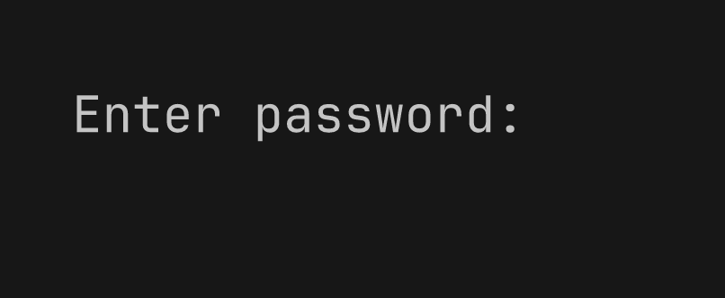
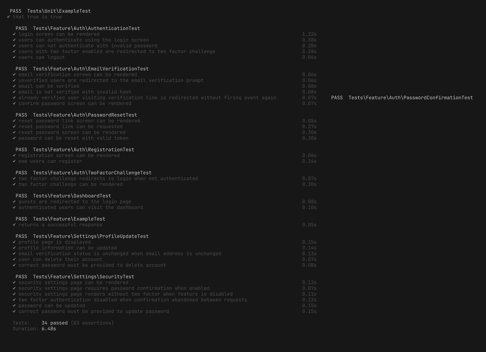

<div align="center">
  <h1>Sistem Kantin Multi-Tenant</h1>
  <p>Aplikasi berbasis web untuk mendukung pengelolaan beberapa kantin dalam satu platform secara terpusat.</p>

  <!-- Badges -->
  
  
  
  
  

  <br>
  <br>

  <!-- Status -->

<b>Status Proyek:</b> 🚧 Dalam Pengerjaan & Pengembangan <br>
<b>Modul 1 Selesai:</b> 📅 28 Oktober 2026
</div>

<hr>

## 📖 Tentang Proyek

Proyek ini dikembangkan sebagai bagian dari praktikum 14 minggu menggunakan pendekatan **Modular Monolith**. Fokus utamanya adalah membangun sistem yang aman, terisolasi antar tenant, dan siap untuk operasional real-time.

---

## ✅ Inti Pengerjaan Modul 1 (Fondasi Teknis)

Pada pertemuan pertama ini, fondasi utama aplikasi berhasil dibangun dan diverifikasi:

1. **Audit Toolchain:** Memastikan PHP 8.3+, Composer, Node.js, MariaDB, dan Redis berjalan di lingkungan lokal.
2. **Instalasi Laravel 13 + Livewire 4:** Menggunakan starter kit resmi untuk fondasi autentikasi dan UI.
3. **Konfigurasi Environment:** Pemisahan database development (`kantin`) dan testing (`kantin_test`), konfigurasi Redis untuk _session/cache/queue_, serta pengaturan timezone (UTC) dan locale (ID).
4. **Pemasangan Reverb:** Menyiapkan fondasi WebSocket untuk fitur _real-time_ di masa mendatang.
5. **Quality Gate:**
    - `php artisan test` → **34 Passed** (83 assertions)
    - `vendor/bin/pint --test` → **PASS** (48 files)
    - `npm run build` → **Build Success**

---

## 📸 Dokumentasi & Evidence

Seluruh bukti teknis (hasil terminal, kualitas kode, dan antarmuka) didokumentasikan dengan rapi di dalam folder **[`docs/evidence/`](docs/evidence/)**.

### Preview Modul 1:

|                  Database & Redis Terhubung                  |               Quality Gate (Test Passed)               |
| :----------------------------------------------------------: | :----------------------------------------------------: |
|  |  |

|                 Tampilan Aplikasi                 |                   Dokumentasi README                    |
| :-----------------------------------------------: | :-----------------------------------------------------: |
|  |  |

---

## 🚀 Panduan Instalasi (Development)

1. Clone repositori ini:
    ```bash
    git clone https://github.com/krisnaandrianwijaya-14/Recode_Kantin_Multi_Tenant_362558302029_KrisnaAndrianWijaya.git
    ```
